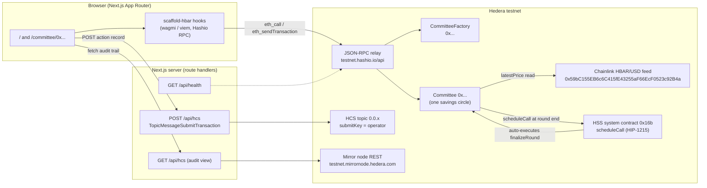
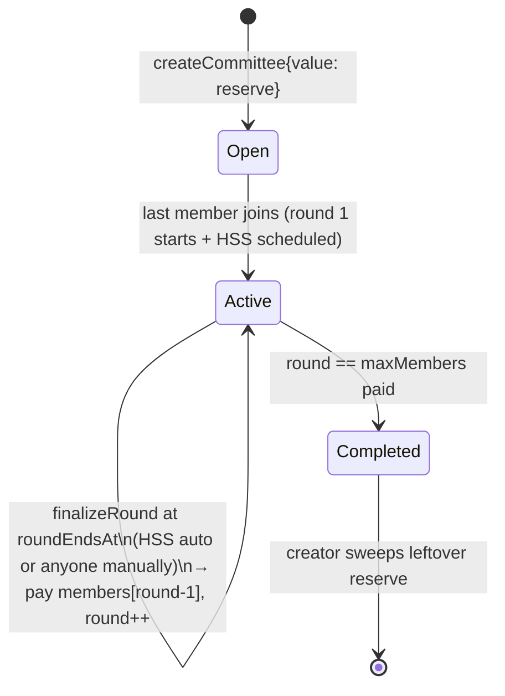

# PLAN — hedera-committee (Phase 1, awaiting approval)

Scope rule: **small and finished beats big and broken.** Everything below is cut to be
complete, tested and documented by Oct 4.

---

## 1. What the product is (one paragraph)

A **USD-denominated digital ROSCA** ("committee" / "BC"). N members promise a fixed USD
amount per round. On-chain there is no USD, so each `contribute()` reads an HBAR/USD
**Chainlink feed** through an adapter and asks the member for exactly that much HBAR
(msg.value, refunded excess). Round by round the whole pot goes to one member in fixed
payout order (join order) until everyone has been paid once. Payouts are executed by the
**Hedera Schedule Service** (HIP-1215 `scheduleCall`) at round end, with a permissionless
manual fallback. Every meaningful contract event is appended to an **HCS** topic by a
server route (operator key server-side only) so the circle has a tamper-evident audit log.
**Without the oracle, `contribute()` cannot compute what "20 USD" means in HBAR — the
integration is load-bearing.**

---

## 2. Architecture



Round lifecycle (contract state machine):



---

## 3. Repository layout

```
hedera-committee/
├── template.json                 # manifest (zod-validated by the CLI, deleted after scaffold)
├── README.md                     # 30-point deliverable
├── AGENTS.md                     # 30-point deliverable
├── LICENSE                       # MIT
├── RESEARCH.md                   # Phase 0 evidence (kept: shows verification trail)
├── PLAN.md                       # this file
├── .env.example                  # root: HCS + operator vars (documented table in README)
├── .gitignore                    # .env, .env.*, !.env.example, node_modules, .yarn/*
├── .github/workflows/ci.yml
├── scripts/verify-gate.sh        # Phase 4 self-audit
├── .husky/pre-commit  .lintstagedrc.js  .yarnrc.yml  .yarn/  (as in scaffold-hbar)
└── packages/
    ├── hardhat/
    │   ├── contracts/
    │   │   ├── interfaces/IPriceOracle.sol
    │   │   ├── interfaces/IAggregatorV3.sol
    │   │   ├── interfaces/IHederaScheduleService.sol
    │   │   ├── oracle/ChainlinkHbarUsdAdapter.sol
    │   │   ├── oracle/MockPriceOracle.sol          # local dev + tests
    │   │   ├── Committee.sol
    │   │   ├── CommitteeFactory.sol
    │   │   └── test/MaliciousReceiver.sol          # reentrancy fixture
    │   ├── deploy/00_deploy_oracle.ts  01_deploy_schedule_mock.ts (local only)  02_deploy_factory.ts
    │   ├── scripts/  (account mgmt from scaffold + hcs/createTopic.ts + demo/testnetDemo.ts + demo/payoutDemo.ts)
    │   ├── test/  (7 files, see §9)
    │   ├── hardhat.config.ts (scaffold baseline, + factory deploy task wiring)
    │   └── mocks/MockScheduleService.sol
    └── nextjs/
        ├── app/page.tsx                              # home: create + committee list
        ├── app/committee/[address]/page.tsx          # detail: rounds, contribute, payouts, audit
        ├── app/debug/page.tsx                        # kept from scaffold (ABI inspector)
        ├── app/api/health/route.ts
        ├── app/api/hcs/route.ts                      # GET list (mirror node) / POST submit (SDK)
        ├── components/…  hooks/…  utils/…            # scaffold baseline (blockexplorer removed)
        └── scripts/smoke.mjs                         # boots `next start`, asserts 200s
```

Based on `templates/blank-template` (Hardhat + Next.js), **Foundry package removed**,
block-explorer UI removed (and its now-orphaned helpers), Debug Contracts kept.

---

## 4. Contracts

### 4.1 Units (measured in Step 0 - RESEARCH.md section 9)

| Quantity | Unit in code |
| --- | --- |
| USD amount per round | `uint256` **1e-6 USD** (e.g. `20_000_000` = $20.00) |
| Oracle price | adapter returns **priceE18** = USD-per-HBAR x 1e18 (feed has 8 decimals -> x10^10) |
| `msg.value`, pot, payouts, `address(this).balance` | **chain-native EVM units**: tinybars (`1 HBAR = 1e8`) on Hedera testnet/mainnet, wei (`1e18`) on the local Hardhat fork - stored as immutable `unitsPerHbar` set by the deploy script (`1e8` Hedera / `1e18` local) |
| tx `value` field sent to hashio | native amount x **relayScale**, `relayScale = 1e18 / unitsPerHbar` (`1e10` Hedera / `1` local) - the relay divides `value` by `1e10` before execution (measured) |

One library owns the conversions: the contract reads `unitsPerHbar`, the frontend quote calls
`committee.usdToNative(usdAmountE6)` (no client-side constants), demo scripts send
`nativeAmount * relayScale`. `MockScheduleService` and every test are deployed with the same
`unitsPerHbar` they assert against.

`requiredNative = ceil(usdAmountE6 * 1e12 * unitsPerHbar / priceE18)` - ceil division so the pot
can never be short; any overpay is refunded in the same tx.


### 4.2 `IPriceOracle` / adapter

```solidity
struct PriceData { bytes32 pairKey; uint256 priceE18; uint256 updatedAt; }
interface IPriceOracle { function latestPrice(bytes32 pairKey) external view returns (PriceData memory); }
```

- `ChainlinkHbarUsdAdapter(address feed, uint256 maxPriceAge)` immutable; single pair
  `keccak256("HBAR/USD")`; implements the official checks: `answeredInRound >= roundId`,
  `updatedAt != 0`, `answer > 0`, `block.timestamp - updatedAt <= maxPriceAge`, then normalizes
  `feed.decimals()` (8) to 18.
- Errors: `OracleUnsupportedPair`, `OracleIncompleteRound`, `OracleInvalidPrice`,
  `OracleStalePrice(updatedAt, maxAge)`.
- `MockPriceOracle` (`setPrice(priceE18)`, `setUpdatedAt(ts)`, `setRevertOnRead(bool)`) used by
  the local deploy script and every test.
- The Committee stores `oracle` + `pairKey` **immutable** — "swappable" means deploy a different
  adapter for a new factory; "mockable" means tests/local pass the mock address.

### 4.3 `CommitteeFactory`

```solidity
createCommittee(uint256 usdAmountPerRound, uint8 maxMembers, uint256 roundDuration,
                uint256 maxPriceAge) external payable returns (address committee)
```

- Immutable: `oracle`, `pairKey`, `scheduleService` (`0x16b` on Hedera, mock locally).
- `msg.value >= MIN_HSS_RESERVE (0.5 HBAR)` → forwarded to the committee as its HSS fee float
  (**never** counted in the pot).
- Validates: `usdAmountPerRound` in [1e6, 1e9] ($1–$1000), `maxMembers` in [2, 10],
  `roundDuration` in [300 s, 30 days], `maxPriceAge` in [60 s, 7 days].
- State/events: `committees[]` + `getCommittees()`, `CommitteeCreated(index, committee, creator, …)`.

### 4.4 `Committee`

State: `status {Open, Active, Completed}`, `creator`, config (all immutable), `members[]`,
`memberIndex`, `round` (1-based), `roundEndsAt`, `pot`, `contributedThisRound`,
`contributorsThisRound`, `pendingSchedule`, `roundPaid[]` (bool → history for cheap views).

External functions:

| Function | Rules |
| --- | --- |
| `join()` | `Open`, not a member, slots free. On the last join → `_startRound(1)` (sets `round=1`, `roundEndsAt=now+roundDuration`, `_schedulePayout()`), status `Active`. |
| `contribute() payable` | `Active`, member, first time this round, `now < roundEndsAt`; `required = quoteContribution()` (adapter reverts on stale/zero/incomplete); `msg.value >= required`; effects first (`pot += required`, mark contributed), then **refund `msg.value - required`**. Non-reentrant. |
| `quoteContribution() view` | `(requiredWei, priceE18, updatedAt)` for the UI. |
| `finalizeRound()` | `Active`, `now >= roundEndsAt`. CEI: receiver = `members[round-1]`, `amount = pot`, `pot = 0`, delete pending schedule (`deleteSchedule`, best-effort), then transfer. If `round == maxMembers` → `Completed`, emit `CommitteeCompleted`; else `round++`, `roundEndsAt += roundDuration`, clear contributions, `_schedulePayout()`. Permissionless ⇒ **HSS auto-execution and manual fallback use the same entry point**. Non-reentrant. |
| `topUpReserve() payable` | anyone; keeps HSS fee float alive. |
| `sweepReserve()` | `creator` only, only when `Completed` (pot is 0 by then). |

Internal: `_schedulePayout()` — if `scheduleService.code.length == 0` → `emit ScheduleSkipped`
(local networks); else probe `hasScheduleCapacity(expiry + i, GAS_LIMIT)` for `i in 0..7`, call
`scheduleCall(address(this), expiry, 1_000_000, 0, abi.encodeCall(finalizeRound, ()))`, require
`rc == 22 && schedule != 0` on success → `PayoutScheduled`; on failure → **emit
`PayoutScheduleFailed(rc)` instead of reverting** (a full round must not be bricked by a
throttled second — manual fallback covers it).

Events (every one mirrored to HCS by the client):
`MemberJoined`, `CommitteeStarted`, `ContributionReceived(round, member, priceE18, usdAmount,
hbarWei, refundWei)`, `PayoutScheduled`, `PayoutScheduleFailed`, `ScheduleSkipped`,
`RoundFinalized(round, receiver, amount, contributors, missed)`, `CommitteeCompleted`,
`ReserveToppedUp`, `ReserveSwept`.

Custom errors (no require-strings): `NotCreator`, `NotOpen`, `NotActive`, `AlreadyMember`,
`NotMember`, `CommitteeFull`, `AlreadyContributed(round)`, `RoundClosed(round)`,
`RoundNotEnded(roundEndsAt)`, `InsufficientContribution(required, sent)`,
`ReserveTooLow(required, sent)`, `NotComplete`, `InvalidConfig(param)`, `ZeroAmount` /
`ZeroAddress` in the factory/adapter.

### 4.5 Edge cases (each has a test)

| Case | Behaviour |
| --- | --- |
| Member defaults (pays nothing) | round still finalises on time; `RoundFinalized` records `contributors` vs `missed`; pot = what was actually collected; no slashing, no exclusion (documented limitation) |
| Late payment | `contribute()` after `roundEndsAt` → `RoundClosed` |
| Oracle stale / zero / incomplete | adapter reverts; `contribute` bubbles the error; nothing moves |
| Rounding | ceil division; dust stays in the pot and goes to the receiver; refund on overpay |
| Reentrancy | OZ `ReentrancyGuard` on `contribute`/`finalizeRound`/`sweepReserve`, CEI ordering, `MaliciousReceiver` test |
| Payout-order fairness | order fixed = join order, frozen at start (no post-start joins), one payout per member per round, exactly `maxMembers` rounds |
| HSS throttled second | failure event, no revert, manual `finalizeRound()` still available |
| Local network (no HSS) | `code.length == 0` → skip + event; tests use `MockScheduleService` |
| Reserve runs dry | scheduled call fails on-network → manual fallback; README tells creators to `topUpReserve()`; UI shows reserve level |
| Payout to an address that cannot receive HBAR | documented limitation (wallet addresses must be Hedera-receivable) |

Dependencies: `@openzeppelin/contracts` (ReentrancyGuard only), `ethers` v6, hardhat-deploy —
exactly the versions in the official `cross-chain-dca` template.

---

## 5. HSS flow (end to end)

1. Committee goes `Active` in `join()` → `_schedulePayout()` probes capacity and calls
   `scheduleCall(this, roundEndsAt, 1_000_000, 0, finalizeRound())` → schedule address stored,
   `PayoutScheduled` emitted.
2. At `roundEndsAt` the network executes `finalizeRound()` **as the contract** (payer = contract,
   fee from the reserve) → members[round-1] receives the pot.
3. Next round is scheduled inside the same call.
4. If step 1/2 never happens (throttling, empty reserve, local network), **anyone** may call
   `finalizeRound()` once `now >= roundEndsAt`; the stale schedule is deleted first.

Nothing is ever placed inside an **Atomic Batch** transaction (deprecated Sept 22, 2026).

---

## 6. HCS flow (audit log only)

- `POST /api/hcs` — body `{ type, committee, round?, txHash?, amount?, note? }` validated against
  an allow-list schema + ≤ 900-byte canonical JSON. Server loads `HEDERA_OPERATOR_ID` /
  `HEDERA_OPERATOR_KEY` / `HCS_TOPIC_ID` from env (server-only), submits
  `TopicMessageSubmitTransaction`, returns `{ sequenceNumber, consensusTimestamp }`.
  Status codes: `400` invalid, `405` wrong method, `502` SDK failure, `503` not configured.
  A tiny in-memory fixed-window rate limit (60 req/min/IP) guards the public endpoint.
  **The key is never sent to the client and never logged.**
- `GET /api/hcs?limit=25` — proxies the mirror node `GET /api/v1/topics/{id}/messages`, decodes
  base64 → JSON, returns `{ configured, topicId, messages[] }`; `200` even when unconfigured
  (`configured:false`, empty list) so the route is always healthy.
- `GET /api/health` — `{ ok, chainId, factory, hcsTopicId }`, used by CI/gate smoke checks.
- Topic is created by `npm run hardhat:hcs:topic --` with **submitKey = operator key**, so only the
  server can append. Client POSTs a record after each successful tx (fire-and-forget + toast on
  failure; the chain stays the source of truth).

---

## 7. Frontend

| Route | Contents | States |
| --- | --- | --- |
| `/` | plain-words explainer of the USD-fixed committee, live oracle price chip, **Create form** (USD/round, members, duration, max price age, HBAR reserve), **Open committees** list from `getCommittees()` | skeleton, empty ("no committees yet"), error, tx pending/success toasts |
| `/committee/[address]` | status + round x/y + countdown, pot (HBAR + USD), contribution progress, HSS schedule badge (Hashscan link or "manual fallback"), **Join** card, **Contribute** card with live `quoteContribution()` (required HBAR, oracle price, age) prefilled into `EtherInput`, members list with per-round ticks, **payout history** table (event-derived, Hashscan tx links), **audit trail** tab (`GET /api/hcs` filtered by committee + topic Hashscan link) | per-card skeleton / error / empty / already-contributed / round-closed |
| `/debug` | scaffold Debug Contracts for the deployed ABIs | as scaffold |
| `/api/health`, `/api/hcs` | see §6 | see §6 |

Wallet: RainbowKit connect on Hedera testnet (Hashio RPC override already in
`scaffold.config.ts`). Writes go through `useTransactor`; every success POSTs an HCS record.
Blockexplorer pages removed (dead weight); all explorer links point at Hashscan.

---

## 8. Deploy & demo scripts

| Script | What it does |
| --- | --- |
| `npm run hardhat:deploy -- --network hederaTestnet` | `00` Chainlink adapter → `02` factory (`scheduleService = 0x16b`); local path instead deploys `MockPriceOracle` + `MockScheduleService`; `generateTsAbis` writes `deployedContracts.ts` |
| `npm run hardhat:hcs:topic --` | creates the HCS topic (submitKey = operator), prints `0.0.x`, writes `HCS_TOPIC_ID` into `packages/nextjs/.env.local` (gitignored) |
| `npm run hardhat:demo:testnet --` | creates a committee (2 members, short round), creates+funds a second ECDSA testnet account in-memory (never printed), both `join`, both `contribute` (quote → send exact), submits HCS records, then **prints Hashscan links**: contract, factory, create/join/contribute txs, topic |
| `npm run hardhat:demo:payout --` | waits for `roundEndsAt`, verifies whether HSS executed `finalizeRound` (falls back to calling it manually), prints the payout tx link |

Rules: private keys only via local `.env` / encrypted keystore, **never logged, never
committed**; `.gitignore` covers `.env`, `.env.*`, `!.env.example`.

---

## 9. Tests

Hardhat (mock oracle + mock HSS, no network needed):

1. `CommitteeFactory.test.ts` — config validation (each bound), min reserve, event, registry.
2. `Committee.fullCycle.test.ts` — 3 members × 3 rounds: join → start → contribute → HSS
   scheduled → `executeDueSchedule()` → payouts in **join order** → `Completed` → `sweepReserve`.
3. `Committee.oracle.test.ts` — stale price, zero price, incomplete round, decimals normalisation
   (8→18), quote math incl. ceil rounding.
4. `Committee.contribution.test.ts` — non-member, double contribute, contribute while `Open`,
   after `roundEndsAt`, underpay, overpay refund (balance deltas), zero value.
5. `Committee.payout.test.ts` — finalize before end, manual finalize deletes pending schedule,
   capacity=false → `PayoutScheduleFailed` without revert, missed-contribution round (pot = 2/3).
6. `Committee.reentrancy.test.ts` — `MaliciousReceiver` re-enters `finalizeRound`/`contribute`
   during payout → guard reverts, state intact.
7. `oracle/ChainlinkAdapter.test.ts` — adapter checks against a scripted `MockAggregatorV3`.

Frontend: `npm run next:smoke --` — builds, boots `next start`, asserts `200` for
`/`, `/debug`, `/committee/0x0000000000000000000000000000000000000001`, `/api/health`,
`/api/hcs?limit=5`, then shuts down (non-zero exit on any failure).

Quality gates: `npm run lint --` (next + hardhat, `--max-warnings=0`), `npm run next:check-types`,
`npm run hardhat:check-types --`, `npm run next:build`, `npm run hardhat:test` — all green locally and in CI.

---

## 10. CI (`.github/workflows/ci.yml`)

Single `ubuntu-latest` / Node 20 job:
`npm install` → `npm run hardhat:compile --` → `npm run hardhat:test` →
`npm run lint -- --max-warnings=0` → `npm run next:check-types` → `npm run hardhat:check-types` →
`npm run next:build --` → `npm run next:smoke`. No network deploys, no secrets required.

---

## 11. Docs outline (Phase 3)

**README.md** — title + one-liner · demo GIF placeholder · what/why in plain words
(the ROSCA problem + HBAR volatility) · how the oracle makes it possible (load-bearing, with the
20 USD → HBAR worked example) · prerequisites · **one-command scaffold** · env var table ·
local run (3 terminals) · testnet deploy (faucet → account → deploy → topic → demo → links) ·
how the oracle works (feed addresses, 8 vs 18 decimals, staleness window, local mock fallback) ·
architecture mermaid · how HSS is used and why (+ manual fallback, reserve) · how HCS is used and
why (audit log not a database, submit key, server-only key) · security notes & limitations ·
troubleshooting table · project structure · **Hashscan links section** · MIT.

**AGENTS.md** — repo map · command table (root scripts only) · conventions (naming, `~~` alias,
scaffold hooks names, `@sh/` scope, events-for-HCS rule) · do/don't (no Atomic Batch, no client-side
keys, no dead code, don't rename scaffold scripts, decimals rules) · how to add a feature
(contract → deploy → ABI regen → hook → UI → HCS record → test) · how to run tests · known pitfalls.

---

## 12. Timeline (today = Oct 1, deadline Oct 4 23:59 ET)

| Day | Deliverables |
| --- | --- |
| **Oct 1** | ✅ RESEARCH.md, this PLAN (approval), base scaffold laid down, contracts + mocks, factory tests green |
| **Oct 2** | Remaining contract tests green, deploy scripts + HCS route + `/api/health`, frontend pages wired |
| **Oct 3** | Smoke test, lint/typecheck/build clean, README + AGENTS.md, CI, `scripts/verify-gate.sh`, testnet deploy + demo → Hashscan evidence |
| **Oct 4** | Full gate self-audit (fresh scaffold in temp dir), fix failures, push public repo, final checklist + honest self-score |

---

## 13. Explicitly out of scope

No HTS tokens, no DEX swap, no subgraph/indexer, no auth on the read path, no mobile layout,
no mainnet deploy, no Hedera Harness (not required; we note in README it wasn't used),
no Foundry package, no Atomic Batch, no blockexplorer pages.

---

## 14. Risks

| Risk | Mitigation |
| --- | --- |
| Testnet HBAR / funded key missing | block on user input now (see questions) |
| HSS throttle at demo time | `hasScheduleCapacity` probe + manual fallback; demo prints both paths |
| Chainlink testnet reporter gaps | `maxPriceAge` is a creation parameter; demo uses a loose bound, README explains |
| npm path diverges from npm run path -- | CI uses yarn (template default); gate script runs the scaffold once with npm too |
| Time | §13 cuts; lowest-priority item is `demo:payout` |
